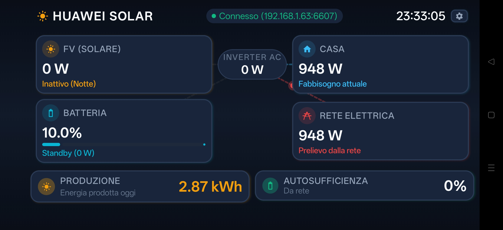

# Huawei TV – Monitoraggio Locale SUN2000
[](https://github.com/CavaBG84/Huawei-SUN-TV/releases)

Applicazione Android leggera per il monitoraggio in tempo reale degli impianti fotovoltaici **Huawei SUN2000** tramite protocollo **Modbus TCP** in rete locale (Wi-Fi / LAN), senza dipendenza dal cloud FusionSolar.

Progettata per rimanere attiva su schermi dedicati, Smart TV, Amazon Fire TV Stick e dispositivi Android (inclusi dispositivi legacy Android 4.4 KitKat).


---

## Download

Scarica l'ultima versione dell'APK dalla sezione **Releases**:

[](https://github.com/CavaBG84/Huawei-SUN-TV/releases/latest)

*(Se nella release sono presenti più file APK, scarica la versione adatta al tuo dispositivo: standard per Android moderno / Fire TV Stick, oppure dedicata per Android 4.4 KitKat).*

---

## Requisiti e Configurazione Inverter

Prima di utilizzare l'app, è necessario abilitare il protocollo **Modbus TCP** sull'inverter Huawei:

1. Apri l'app **FusionSolar** e connettiti localmente all'inverter (o accedi con account Installatore).
2. Vai in **Impostazioni** → **Impostazioni di comunicazione** → **Impostazioni Dongle** (oppure **Modbus TCP**).
3. Imposta **Modbus TCP** su **Abilita (senza restrizioni)** / *Enable (Unrestricted)*.
4. Salva le impostazioni.

### Configurazione Rete Consigliata
* Assegna un **IP statico** (o prenotazione DHCP sul router) all'inverter / Smart Dongle, così da non dover modificare l'indirizzo nell'app dopo un riavvio del router.
* Assicurati che la TV o il dispositivo Android e l'inverter si trovino sulla **stessa rete locale (stessa sottorete)**.

---

## Impostazioni dell'App

Al primo avvio, apri il menu impostazioni dell'app e inserisci i seguenti parametri:

| Parametro | Valore standard | Note |
| :--- | :--- | :--- |
| **Indirizzo IP** | es. `192.168.1.50` | L'IP locale assegnato al tuo inverter / Smart Dongle |
| **Porta Modbus** | `6607` (o `502`) | `6607` per inverter SUN2000-L1, `502` per Smart Dongle |
| **Slave ID / Unit ID** | `1` (oppure `0`) | Usa `1` per Smart Dongle WiFi-FE, `0` per connessione diretta AP |

---

## Installazione (Sideloading)

### Su Android TV / Smartphone / Tablet
1. Scarica il file `.apk` dalla sezione **Releases**.
2. Abilita l'installazione da **Origini sconosciute** nelle impostazioni di sicurezza del dispositivo.
3. Apri il file `.apk` tramite un file manager e conferma l'installazione.

### Su Amazon Fire TV Stick
1. Vai in **Impostazioni** → **La mia Fire TV** → **Opzioni sviluppatore** e attiva **App da fonti sconosciute** (e **Debug ADB** se installi da PC).
2. **Metodo A (app Downloader):** installa l'app *Downloader* dallo store Amazon, inserisci il link diretto dell'APK preso dalla pagina Releases e installa.
3. **Metodo B (da PC via ADB):**
   ```bash
   adb connect IP_DELLA_FIRE_TV:5555
   adb install nome_file_app.apk
   ```
### Su Amazon Fire TV Stick (senza PC / ADB)
1. Installa l'app gratuita **Downloader** (di AFTVnews) dallo store Amazon della Fire TV.
2. Vai in **Impostazioni** → **La mia Fire TV** → **Opzioni sviluppatore** → **Installa app sconosciute** e attiva l'opzione per **Downloader**.
3. Apri **Downloader**, seleziona la barra dell'indirizzo e digita il codice corrispondente alla tua versione:
   * **Versione standard (Android moderno / Fire TV Stick):** `9183283`
   * **Versione legacy (Android 4.4 KitKat):** `1728411`
4. Attendi il download automatico e conferma su **Installa**.
---

## Supporta il Progetto

Questa app è gratuita e priva di pubblicità. Se ti è utile per monitorare il tuo impianto, puoi offrire un caffè tramite PayPal:

[-00457C?style=for-the-badge&logo=paypal&logoColor=white)](https://www.paypal.me/cavalleridaniele/2EUR)

Oppure inquadra il QR Code:


---

## Licenza
Copyright (c) 2026 Daniele Cavalleri. All rights reserved.
Questo progetto è distribuito come software proprietario gratuito (**All Rights Reserved**). Il codice sorgente non è pubblico. Consulta il file [LICENSE](LICENSE) per i dettagli.
